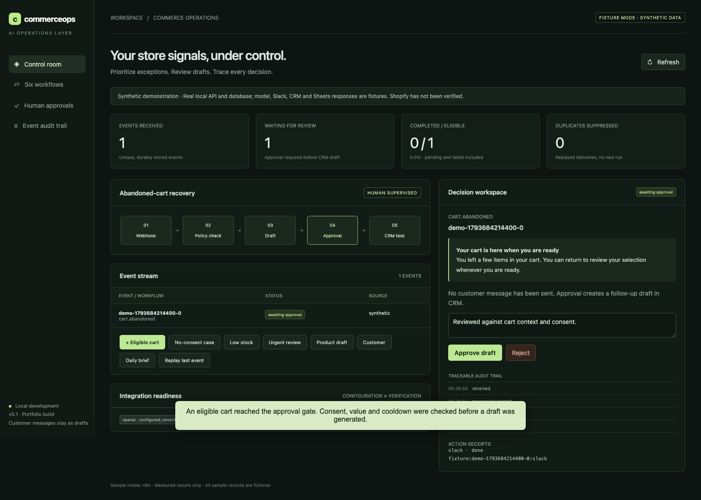
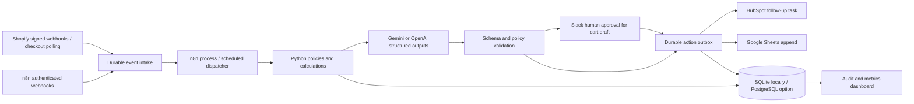
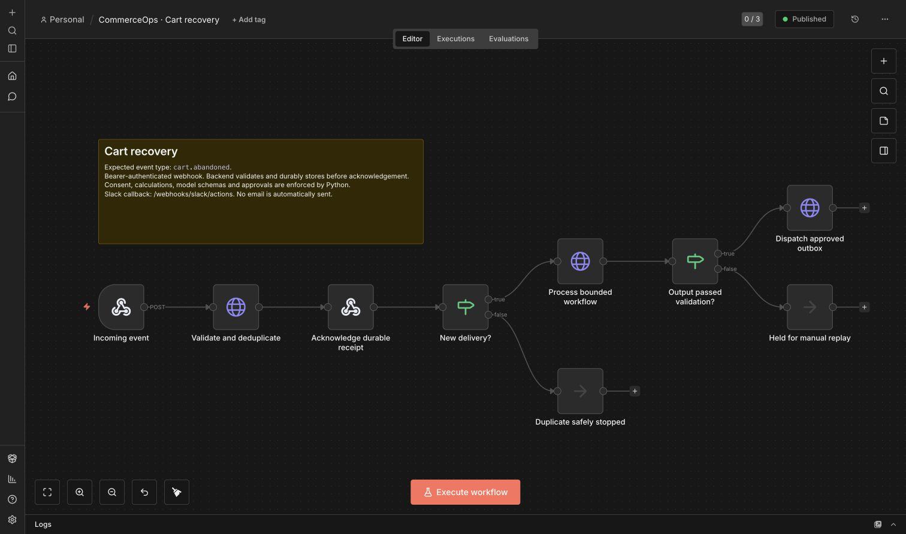

# CommerceOps AI

A human-supervised commerce operations system: store signals become validated drafts, exception alerts, CRM follow-up tasks and traceable reports.

[](https://github.com/aaditya599fx/commerceops-ai/actions/workflows/ci.yml)

**Reviewer page:** [Open the hosted preview](https://commerceops-ai-aaditya-review.aadityay793.chatgpt.site) (currently owner-private; public access awaits approval).

**Start here:** [Reviewer guide](docs/REVIEWER_GUIDE.md) · [3:40 complete walkthrough](evidence/reviewer-walkthrough.mp4) · [1:12 live integration proof](evidence/live-demo.mp4) · [Resume and interview wording](docs/RESUME.md).

**Current evidence:** a running local application with six implemented workflows, nine actual n8n exports, 65 passing tests and CI. A synthetic cart completed through real n8n intake, Gemini 3.5 Flash-Lite, an actual signed Slack human decision, a HubSpot task and a Google Sheets append. Independent reads confirmed exactly one matching task and one report row after duplicate replay. A no-consent event was blocked before generation or outbound actions. The six-workflow model smoke sample also passed schema and local policy checks. These small live samples do not establish production reliability or model accuracy.

Shopify shop/product/order/customer/abandoned-checkout reads and three minimal webhook subscriptions are verified. **A genuine Shopify products/create webhook completed through signed ingress, n8n and Gemini into a local content draft.** Shopify reported 200 OK on attempt 1; API readback confirmed the source product stayed unpublished with zero price and quantity. [Product-delivery evidence](evidence/shopify-live-delivery.md). The first two temporary tunnels expired before recovery; the current endpoint is temporary and stable hosting has not been configured. This is a portfolio project, not a CommerceV3 internal system.



[Live demonstration](evidence/live-demo.mp4) · [Live cart measurements](evidence/live-cart-demonstration.md) · [Live Shopify delivery](evidence/shopify-live-delivery.md) · [Fixture walkthrough](evidence/demo.mp4) · [Measured reliability](evidence/reliability.md) · [Raw measurements](evidence/reliability.json) · [Setup](docs/setup.md) · [Live verification](docs/live-verification.md) · [Runbook](docs/runbook.md)

## Run locally

Requires Python 3.11–3.13. From the repository directory:

```bash
./scripts/start.sh
```

Open http://localhost:8000 and enter `APP_TOKEN` from the generated `.env`. The default `fixture` mode uses fictional records and deterministic provider responses. The Python API, schema validation, SQL persistence, approvals, audit trail and failure handling are real. No customer email is sent. Fixture Slack/HubSpot/Sheets action receipts are visibly labelled `fixture:`.

Click **Eligible cart**, inspect the draft, then approve or reject. Click **Replay last event** to demonstrate duplicate suppression, or **No-consent case** to see a policy block. The other sample buttons exercise inventory, reviews, product drafts, customer segmentation and executive reporting.

## Reviewer page

`review/` contains a static, accessible walkthrough of all six workflows with saved inputs, outputs, audit records and explicitly labelled fixture receipts. It also presents the separate live Shopify/cart evidence and recordings. Build it with `.venv/bin/python scripts/build_review_bundle.py`, then serve `runtime/reviewer-site` using Python's HTTP server. No service keys or running external integrations are needed for this recorded explorer. Buttons inspect saved examples; the local FastAPI app above executes new events.

A [fresh-source HTTP check](evidence/reviewer-clean-start.json) ran all six workflows, a no-consent block and duplicate replay with blank service credentials. Existing installed Python dependencies were reused for that check; clean dependency installation is covered by CI.

## Architecture



The backend can run its single-process worker by default, so the application works without n8n. Set `WORKER_ENABLED=false` when using n8n as the orchestration owner. n8n acknowledges only after database intake, skips duplicate deliveries, invokes the bounded processor, branches on validation failure and dispatches persisted actions. Signed Shopify webhooks enter Python directly to preserve raw-body signature verification; n8n's scheduled dispatcher drains that queue.

## Workflows

| Workflow | Deterministic work | Model task / output | Action boundary |
|---|---|---|---|
| Cart recovery | Consent, item totals, minimum value, purchase check, cooldown | Neutral structured recovery draft | Human approval before CRM draft; never sends email |
| Inventory watch | Days of cover and reorder units | Summary and recommendation | Alert only; no purchase orders |
| Review intelligence | Input/rating validation | Sentiment, category, urgency, source quote | Urgent Slack alert and support task |
| Product growth | Source grounding and JSON-LD assembly | Extractive SEO/meta/FAQ draft | Saved for editing; never publishes |
| Customer intelligence | First-time/repeat/high-spend/dormant/at-risk segment | Explanation and suggestion | CRM follow-up task |
| Executive brief | Currency-separated order totals, known/unknown refunds, AOV | Narrative based on supplied metrics | Spreadsheet log; source record IDs retained |

`workflows/` contains actual n8n CLI exports. Six event workflows plus a queue dispatcher, Shopify checkout poll and daily 09:00 Asia/Kolkata brief schedule. Imported workflows are disabled by default in a fresh install; publish intentionally after configuring credentials. `scripts/build_workflows.py` creates import candidates under ignored `runtime/import/`, not exported evidence.



## Real integrations

Fill `.env` locally, run read-only probes with `python scripts/check_connections.py`, then follow [the live setup checklist](docs/setup.md). Switch to `APP_MODE=live` only after configuring the intended services. Missing credentials fail closed; live mode never falls back to fixtures.

- Shopify: [API read verification](evidence/shopify-verification.json) and [genuine product webhook verification](evidence/shopify-live-delivery.json); raw-body HMAC plus exact shop-domain verification; signed order/product webhooks; Admin GraphQL shop probe, current customer consent/purchase context and paginated abandoned-checkout polling. Inventory requires a supplied sales-velocity/lead-time input; these numbers are never fabricated.
- Model API: select Gemini (`LLM_PROVIDER=gemini`) or OpenAI (`LLM_PROVIDER=openai`). Both use JSON Schema and local validation with bounded retries; failed credentials never switch providers. Gemini uses native generateContent; OpenAI uses Responses with `store=false`. Prompt is versioned in `prompts/`. Email and customer IDs are omitted from model input.
- Slack: Web API approval messages; signed interactive callbacks; five-minute signature age limit; explicit reviewer ID allowlist.
- HubSpot: real Tasks API. Customer communications remain internal CRM drafts. No automated email channel is implemented.
- Google Sheets: service-account authentication, real append API, `RAW` values to prevent formula interpretation.

## Validation and honest metrics

```bash
python -m pytest -q
python scripts/evaluate.py
```

The recorded fixed workload used **161 unique synthetic events**, **152 completed eligible runs**, **9 policy-blocked runs**, **30 suppressed duplicate deliveries**, and **0 duplicate recorded action keys**. Full denominators and limitations are in `evidence/reliability.json`. Fixture schema validity is not evidence of model quality. The current real-model sample is preserved in [live-model-smoke.json](evidence/live-model-smoke.json). Earlier provider failures remain in [gemini31-model-smoke.json](evidence/gemini31-model-smoke.json) and [openai-model-smoke.json](evidence/openai-model-smoke.json). The separate live cart sample and its denominators are in [live-cart-demonstration.md](evidence/live-cart-demonstration.md). External delivery is not guaranteed exactly once. Human approval time, model classification accuracy, monetary cost, time savings and revenue lift have not been measured.

Failure tests include absent consent, changed consent, recent purchase, cooldown, rejected approval, malformed output, unsafe copy, API rate limiting/outage, invalid signatures, unauthorized reviewers, ambiguous remote writes and restart recovery. See `evidence/pytest.txt` for the executed test result.

## Limits

Use one API/worker process; the current worker uses an in-process execution lock. PostgreSQL connection support and Docker Compose are supplied but were not exercised on this host. Remote write timeouts are held for manual reconciliation rather than automatically repeated. An interrupted external call can have succeeded remotely; inspect the source service before taking further action. No Shopify production experience, live reliability or business impact is claimed by this repository.

Product copy is intentionally extractive to make factual grounding enforceable. SEO ranking gains are unmeasured. Executive business metrics use ingested order facts; they are not a complete accounting ledger. Gross merchandise sales, currency conversions, tax treatment, broad historical backfill and production multi-tenant isolation are outside the current MVP.

## Repository

`backend/` application and adapters · `workflows/` n8n exports · `data/` fictional records · `prompts/` versioned prompt · `tests/` behavioral and failure tests · `docs/` setup and runbooks · `evidence/` demonstration and actual measurements.

Live outbound actions default to paused (ENABLE_EXTERNAL_WRITES=false). Slack decisions are durably queued before acknowledgement. Order webhook replay and out-of-order updates are handled explicitly; see the live verification runbook.

An earlier failed isolated real-model cart attempt is preserved in [live-workflow-check.json](evidence/live-workflow-check.json): it failed closed on exhausted OpenAI API credits and dispatched no actions. The later successful Gemini run is documented separately in live-cart-demonstration.md. Real API/transport checks are summarized in [live-readiness.json](evidence/live-readiness.json).
